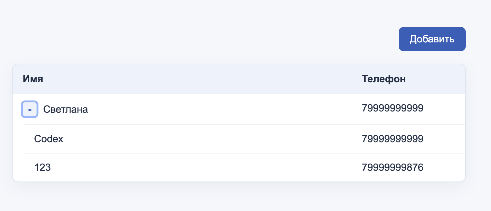

# Users Table

A Vue.js application for managing users and their hierarchical relationships through an interactive table.

Originally built as a practice project focused on working with structured data and interactive UI components.

## Preview



[Live demo](https://petrunenkovas.github.io/usersTable/) (available after GitHub Pages deployment)

## Features

- Add users and assign an optional manager
- Expand and collapse subordinate rows
- Sort users by name or phone

## Tech Stack

- Vue 2
- Vue Router
- JavaScript
- HTML / CSS

## Technical Highlights

- Representation of hierarchical user data
- Interactive table functionality
- Browser-local data persistence

## Getting Started

Clone the repository, install dependencies, and build the application.

```bash
npm ci
npm run build
python3 -m http.server 8765 --directory dist
```

Open http://localhost:8765/ to view the local build.

## Project Status

This is an early learning project that retains its original Vue 2 stack.

The repository is preserved as part of my development history. Any subsequent improvements are documented separately.
